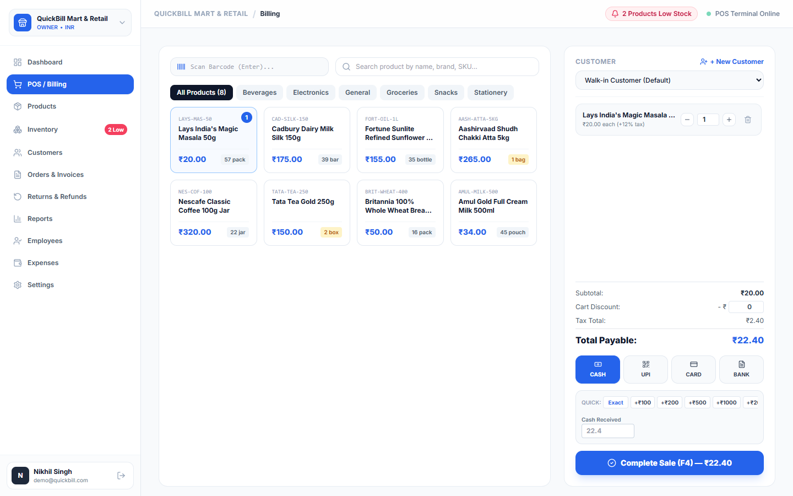
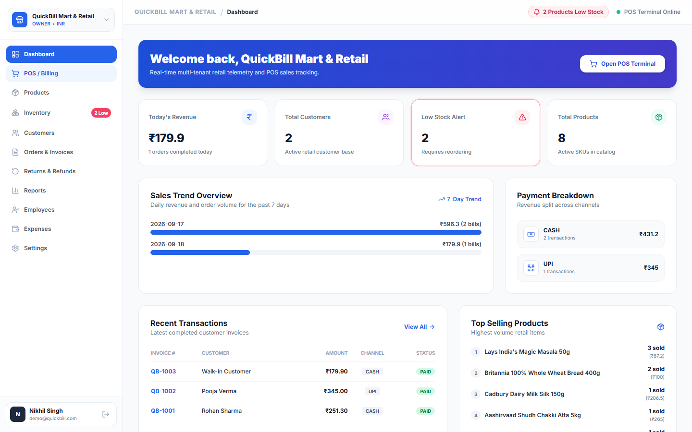
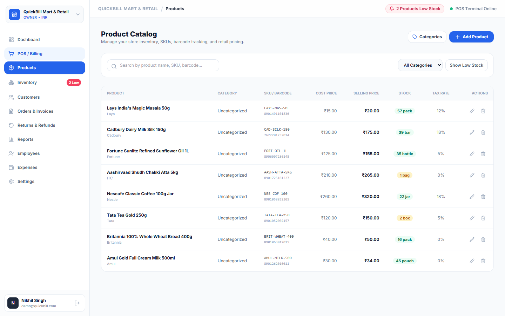
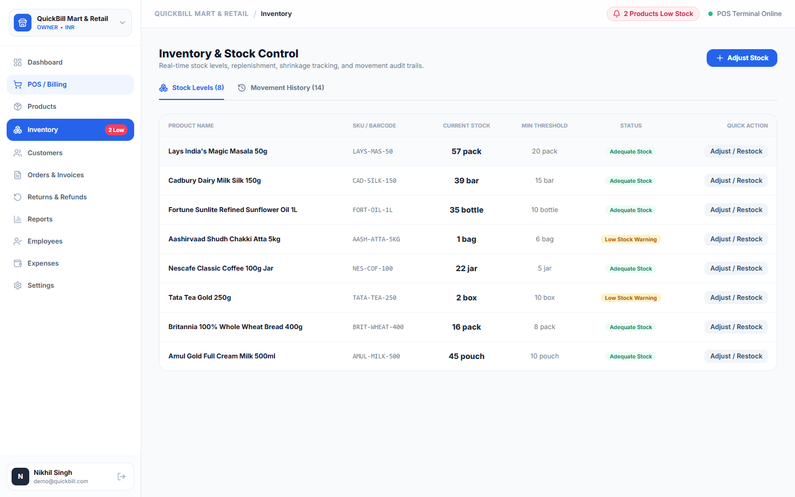
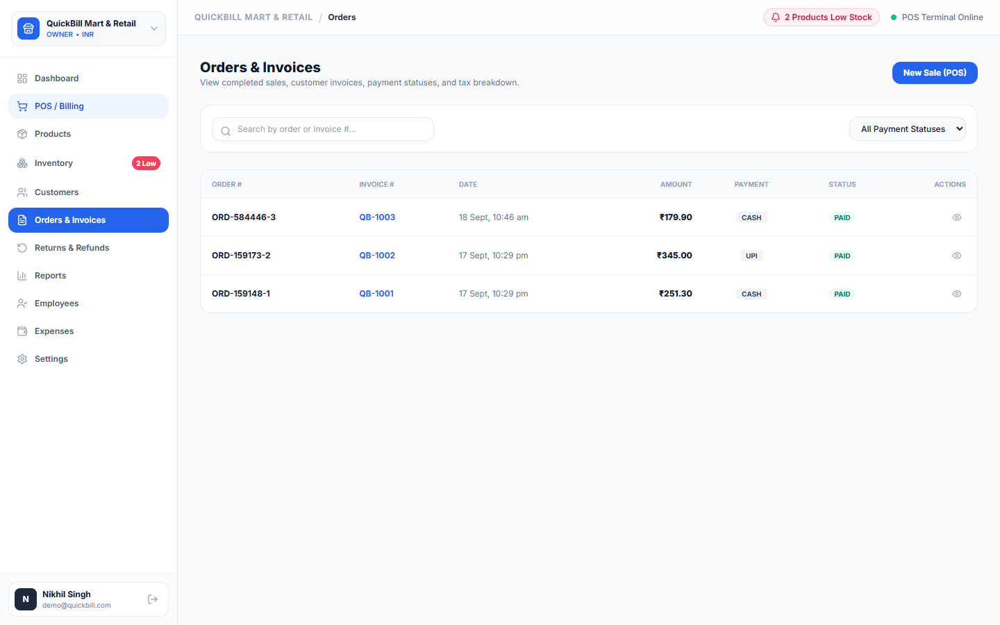
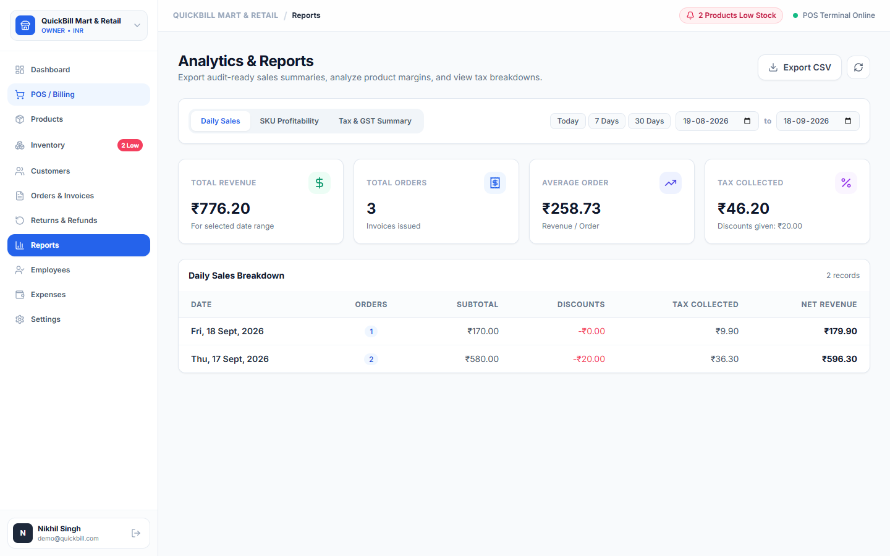
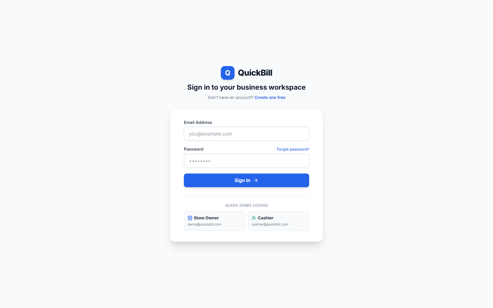
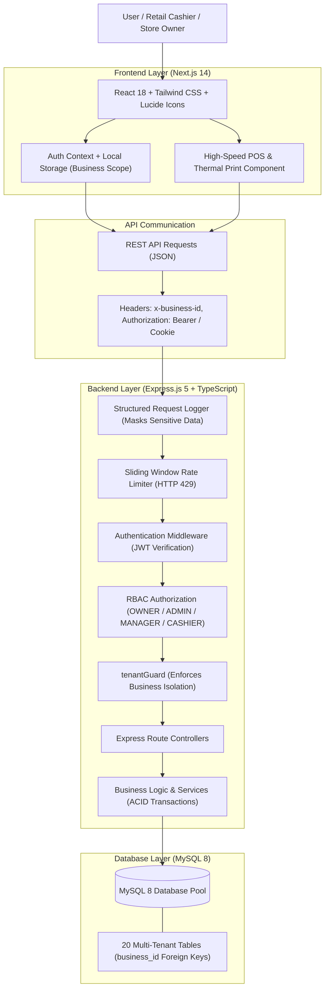

# QuickBill — Complete SaaS Billing & Point-of-Sale (POS) Platform

[](https://nextjs.org/)
[](https://react.dev/)
[](https://www.typescriptlang.org/)
[](https://expressjs.com/)
[](https://www.mysql.com/)
[](https://tailwindcss.com/)

QuickBill is a multi-tenant billing, inventory control, and Point-of-Sale (POS) SaaS platform architected for small and medium retail businesses, supermarkets, and specialty shops to manage sales, stock levels, customer relationships, tax compliance, and business analytics from a unified workspace.

---

## 📑 Table of Contents
- [Project Overview](#-project-overview)
- [Application Preview & Screenshots](#-application-preview--screenshots)
- [Key Features](#-key-features)
- [System Architecture](#-system-architecture)
- [Database Schema & Multi-Tenancy Model](#-database-schema--multi-tenancy-model)
- [Technology Stack](#-technology-stack)
- [Getting Started](#-getting-started)
- [Pre-Configured Demo Credentials](#-pre-configured-demo-credentials)
- [Automated Testing & Verification](#-automated-testing--verification)
- [Database Backup & Disaster Recovery](#-database-backup--disaster-recovery)
- [License](#-license)

---

## 🌟 Project Overview

### The Problem
Traditional small retailers often rely on disjointed software: one desktop tool for barcode billing, a notebook or spreadsheet for stock reconciliations, and manual bookkeeping for GST filing. These systems lack real-time stock deductions, risk overselling during peak hours, distort historical profit margins when supplier prices change, and provide zero multi-store visibility.

### The Solution
QuickBill solves these operational bottlenecks by providing a full-stack, multi-tenant POS and store management suite:
1. **High-Speed Checkout:** Keyboard-driven terminal with barcode scanner input, editable quantities, fast cash denomination buttons, and instant thermal receipt printing.
2. **ACID Transactional Integrity:** Row-locking (`SELECT ... FOR UPDATE`) prevents inventory overselling during simultaneous cash registers.
3. **Historical Profit Accuracy:** Order items snapshot supplier cost price at the exact moment of sale so past financial reports remain stable regardless of future price hikes.
4. **Strict Multi-Tenant Isolation:** Database records are strictly bound to business organizations, enforced at both the middleware (`tenantGuard`) and SQL query layers.

---

## 📸 Application Preview & Screenshots

### 1. High-Speed POS Billing Terminal
*Barcode scanning, category filtering, keyboard hotkeys (`F2`/`F4`/`Esc`), editable item quantities, one-tap cash denominations, and thermal receipt generation.*


### 2. Business Overview Dashboard
*Real-time retail telemetry, KPI revenue cards, 7-day sales trend overview, payment method distribution, and top-selling SKUs.*


### 3. Product Catalog Management
*SKU generation, barcode indexing, category associations, tax slab assignments, cost vs. selling prices, and threshold badges.*


### 4. Inventory Control & Movements Audit
*Real-time stock levels, low-stock alerts, replenishment and shrinkage adjustments (`RESTOCK`, `PURCHASE`, `DAMAGE`), and complete movement audit history.*


### 5. Orders Ledger & Invoice Management
*Chronological sales ledger, sequential invoice numbers (`QB-1001`), payment status indicators, and browser-direct thermal printing.*


### 6. Analytics & Audit Reports
*Audit-ready sales summaries, gross profit reporting using cost-price snapshotting, GST tax liabilities grouped by rate slabs, and one-click CSV data export.*


### 7. Workspace Authentication & Onboarding
*Clean authentication interface with instant demo login buttons, OTP password recovery, and multi-business onboarding.*


---

## ⚡ Key Features

### 🛒 High-Speed Point of Sale (POS)
- **Instant Barcode Search:** Scan physical barcodes or search by SKU/product name.
- **Client-Side Cart with Server-Side Validation:** Prices, GST rates, and line discounts are verified and recalculated on the server to prevent tamper.
- **Ergonomic Controls:** Direct editable numeric quantity inputs with stock clamping, plus hotkeys (`F2` to focus barcode search, `F4` to complete sale, `Escape` to dismiss).
- **Payment Method Flexibility:** Support for Cash, UPI / QR, and Debit/Credit Cards. Quick tender pills (`Exact`, `+₹100`, `+₹200`, `+₹500`, `+₹1000`, `+₹2000`) for rapid change calculation.
- **Thermal Receipts:** 80mm receipt format optimized for thermal POS printers with browser direct print token authentication.

### 🏢 Multi-Tenant Security & Isolation
- **Tenant Scope Enforcement:** Every entity is bounded by `business_id`.
- **`tenantGuard` Middleware:** Validates user membership against the `business_members` table for each incoming `x-business-id` header. Cross-tenant access is rejected with `403 FORBIDDEN`.
- **Cross-Tenant Customer Injection Prevention:** Orders explicitly verify customer records against the active tenant.

### 📦 Inventory & Stock Control
- **Atomic Stock Deduction:** Database row-locking (`SELECT ... FOR UPDATE`) prevents race conditions and overselling.
- **Duplicate Cart Consolidation:** Automatically merges duplicate scanned items before acquiring locks.
- **Stock Movement Ledger:** Complete audit tracking of changes (`SALE`, `RESTOCK`, `DAMAGE`, `ADJUSTMENT`, `RETURN`) recording before and after stock levels.
- **Low-Stock Telemetry:** Instant visual alerts when stock drops below configured minimum thresholds.

### 📊 Accurate Financial Reports & GST Compliance
- **Historical Profit Integrity:** `order_items` stores historical `cost_price` snapshots, ensuring future supplier cost adjustments do not retroactively distort past accounting records.
- **GST Slabs:** Breakdown of turnover and tax liabilities across 0%, 5%, 12%, 18%, and 28% slabs for GSTR-1 preparation.
- **Audit-Ready Exports:** One-click CSV downloads for daily sales and SKU profitability.

### 🛡️ Production Hardening
- **Sliding-Window Rate Limiter:** In-memory sliding-window protection on `/api/v1/auth/login`, `/register`, `/send-otp`, `/verify-otp`, and `/reset-password` returning standard `429 TOO_MANY_REQUESTS` and `Retry-After`.
- **Request Logging:** Structured application logging recording timestamp, request ID, HTTP method, URL, status code, and latency, with recursive masking of passwords, OTPs, tokens, and secrets.
- **Debounced Search:** 300ms input debouncing across Products, Customers, Orders, and Expenses to eliminate database query storms.
- **Selective Lazy Loading:** Heavy analytics widgets loaded dynamically via `next/dynamic` to maintain sub-second initial dashboard render times.
- **Disaster Recovery:** Standalone MySQL schema and data backup/restore scripts (`npm run db:backup` and `npm run db:restore`) requiring zero external CLI dependencies.

---

## 🏛️ System Architecture

QuickBill follows a clean, decoupled three-tier architecture connecting a responsive Next.js frontend with an Express.js API backend and a relational MySQL 8 storage engine:



### Request Lifecycle
1. **Client Request:** Next.js sends JSON payloads to `/api/v1/*` attaching the active `x-business-id` header and JWT authorization.
2. **Operational Safeguards:** The `requestLogger` logs the call with a unique `X-Request-Id`, while `rateLimiter` verifies incoming IP frequencies.
3. **Security Pipeline:** `authenticateUser` validates the JWT token; `requireRoles` enforces RBAC; `tenantGuard` verifies business membership.
4. **Service Transaction:** The service layer begins a database transaction (`connection.beginTransaction()`), locks inventory with `FOR UPDATE`, commits changes, and records audit logs.

---

## 🗄️ Database Schema & Multi-Tenancy Model

QuickBill utilizes a single-database multi-tenant design with tenant column scoping. Every core entity includes a foreign key constraint pointing back to `businesses(id)`.

| Table Name | Primary Purpose | Tenant Key |
|---|---|---|
| `users` | System user accounts, hashed passwords, and profile data | — |
| `businesses` | Tenant organization, tax percentage, invoice prefix, currency | `id` |
| `business_members` | Tenant membership mapping users to roles (`OWNER`, `ADMIN`, `CASHIER`) | `business_id` |
| `stores` | Physical branch stores belonging to a business | `business_id` |
| `categories` | Product categorization and taxonomy | `business_id` |
| `products` | Catalog items, SKUs, barcodes, cost/selling prices, tax rates, stock | `business_id` |
| `inventory_movements` | Immutable audit ledger of all stock increases, sales, and adjustments | `business_id` |
| `customers` | Retail customer CRM, total lifetime spend, and GSTINs | `business_id` |
| `orders` | Completed retail transactions, payment methods, order totals | `business_id` |
| `order_items` | Line items snapshotting `unit_price`, `cost_price`, tax, and discount | via `order_id` |
| `invoices` | Tax invoices with sequential numbers (`QB-1001`), payment status | `business_id` |
| `returns` | Refund records linked to invoices with atomic stock restoration | `business_id` |
| `return_items` | Individual line items returned and restocked | via `return_id` |
| `expenses` | Store expenditures categorized by rent, utilities, inventory, payroll | `business_id` |
| `audit_logs` | Security and event log recording user actions and IP addresses | `business_id` |
| `otp_verification` | Time-limited 6-digit OTP codes for password recovery | — |

---

## 💻 Technology Stack

| Layer | Technologies |
|---|---|
| **Frontend** | Next.js 14 (App Router), React 18, TypeScript 5, Tailwind CSS 3.4, Lucide React |
| **Backend** | Node.js, Express.js 5, TypeScript 5, `mysql2` connection pool |
| **Database** | MySQL 8.0 with InnoDB (Row-level locking, foreign keys, transactions) |
| **Authentication** | JSON Web Tokens (JWT), HTTP-only cookies, bcryptjs password hashing |
| **Testing & Tooling** | `tsx` TypeScript execution, custom test suites, Puppeteer UI automation |

---

## 🚀 Getting Started

### Prerequisites
- **Node.js:** v18.0.0 or higher
- **MySQL Server:** 8.0 or higher running locally or remotely

### 1. Clone the Repository
```bash
git clone https://github.com/s-nikhil2005/QuickBill.git
cd QuickBill
```

### 2. Configure Environment Variables
Copy `.env.example` to `backend/.env`:
```env
PORT=5000
CLIENT_URL=http://localhost:3000

# MySQL Connection
DB_HOST=localhost
DB_PORT=3306
DB_USER=root
DB_PASSWORD=YourMySQLPassword
DB_NAME=quickbill

# Authentication
JWT_SECRET=quickbill_super_secret_jwt_key_2026_production
JWT_EXPIRES_IN=7d
```

### 3. Database Migration & Seeding
```bash
cd backend
npm install
npm run migrate
npm run seed
```

### 4. Start the Backend Server
```bash
cd backend
npm run dev
```
*Backend runs on `http://localhost:5000`.*

### 5. Start the Frontend Application
```bash
cd frontend
npm install
npm run dev
```
*Frontend runs on `http://localhost:3000`.*

---

## 🔑 Pre-Configured Demo Credentials

The seed script initializes ready-to-test accounts preloaded with a demo supermarket catalog, customers, past invoices, and stock movements:

| Role | Email | Password | Access Privileges |
|---|---|---|---|
| **Store Owner** | `demo@quickbill.com` | `Password@123` | Full control, financial reports, catalog, settings, staff |
| **Cashier Staff** | `cashier@quickbill.com` | `Password@123` | POS terminal, checkout, thermal receipt printing, customer search |

> 💡 **Quick Login:** On the `/login` page, you can click **"Store Owner"** or **"Cashier"** under "Quick Demo Logins" to sign in instantly with one click.

---

## 🧪 Automated Testing & Verification

QuickBill includes 3 comprehensive automated test suites:

### 1. Multi-Tenant Isolation Suite
```bash
cd backend
npm test
```
*Verifies tenant creation, isolation boundaries, product scoping, and atomic stock deductions.*

### 2. Retail Production Audit Suite
```bash
cd backend
npx tsx src/__tests__/production_audit.test.ts
```
*Tests cross-tenant customer injection prevention, cart item consolidation, cost price snapshotting for historical profit stability, and customer lifetime spend deductions on returns.*

### 3. Production Hardening Suite
```bash
cd backend
npx tsx src/__tests__/hardening.test.ts
```
*Tests in-memory sliding window rate limiting (HTTP 429 rejection), logger sensitive key redaction, and pagination limit enforcement.*

### Production Build Verification
```bash
# Verify backend TypeScript compilation
cd backend
npm run build

# Verify frontend Next.js production build
cd frontend
npm run build
```

---

## 📦 Database Backup & Disaster Recovery

QuickBill includes standalone, zero-external-dependency database backup and restore scripts built directly on Node.js and `mysql2`. No local `mysqldump.exe` or host PATH configuration is required.

### Create Database Backup
```bash
cd backend
npm run db:backup
```
- Creates complete DDL (`CREATE TABLE`) and row data (`INSERT`) statements with foreign key integrity checks disabled during restore.
- Serializes MySQL JSON fields and timestamps accurately.
- Saves snapshot to `backend/backups/quickbill_backup_<timestamp>.sql`.

### Restore Database
```bash
cd backend
# Restore most recent backup:
npm run db:restore

# Or restore a specific backup file:
npm run db:restore -- backups/quickbill_backup_2026-09-18T04-49-42-124Z.sql
```

---

## 📄 License
This project is open-source software licensed under the [MIT License](LICENSE).
